# Monitorización

## 1. Procesos y CPU

### `ps`
* **Finalidad:** Muestra una instantánea de los procesos activos.
* **Sintaxis:** `ps [opciones]` (Ej: `ps aux`)
* **Captura:** 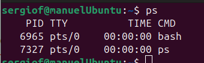
* **Interpretación:** Lista los procesos con su PID, usuario y consumo de CPU/memoria.

### `top`
* **Finalidad:** Muestra en tiempo real los procesos y el uso global de CPU y memoria.
* **Sintaxis:** `top [opciones]` (Ej: `top -u usuario`)
* **Captura:** 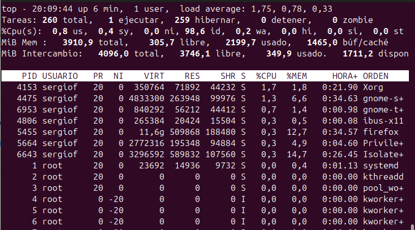
* **Interpretación:** Detalla la carga del sistema y los procesos que más recursos consumen.

### `htop`
* **Finalidad:** Versión interactiva y visual de `top` con soporte de ratón y colores.
* **Sintaxis:** `htop`
* **Captura:** 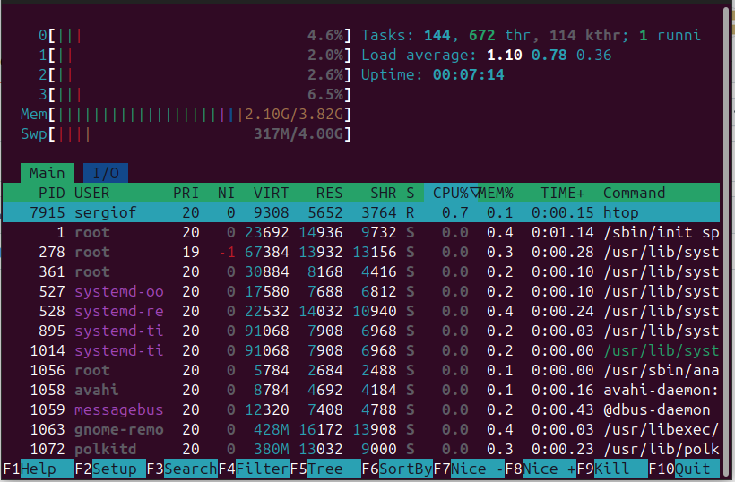
* **Interpretación:** Permite ver el uso por núcleo de CPU y gestionar procesos fácilmente.

### `atop`
* **Finalidad:** Monitoriza de forma avanzada el uso global e histórico de los recursos.
* **Sintaxis:** `atop [opciones]` (Ej: `atop -m`)
* **Captura:** 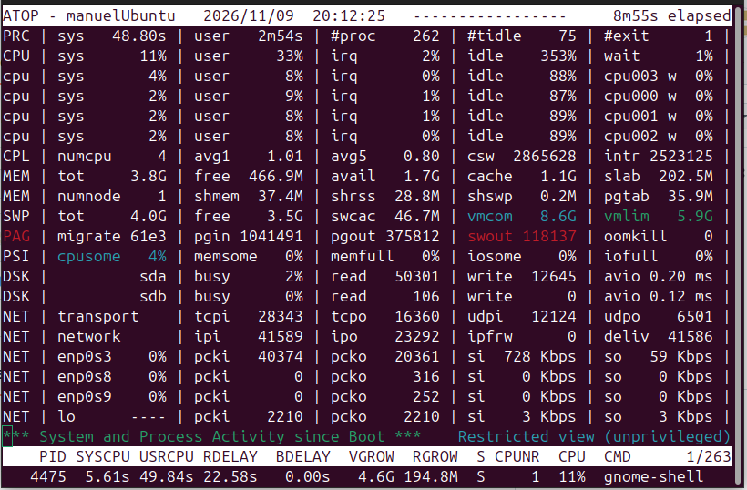
* **Interpretación:** Ayuda a identificar cuellos de botella combinando CPU, memoria y disco.

---

## 2. Memoria RAM

### `free`
* **Finalidad:** Muestra la memoria RAM total, usada y disponible.
* **Sintaxis:** `free [opciones]` (Ej: `free -h`)
* **Captura:** 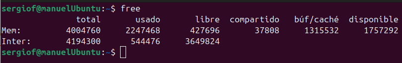
* **Interpretación:** La columna `available` indica la memoria real libre para nuevas aplicaciones.

---

## 3. Almacenamiento

### `df`
* **Finalidad:** Muestra el espacio disponible en los sistemas de archivos y particiones.
* **Sintaxis:** `df [opciones]` (Ej: `df -h`)
* **Captura:** 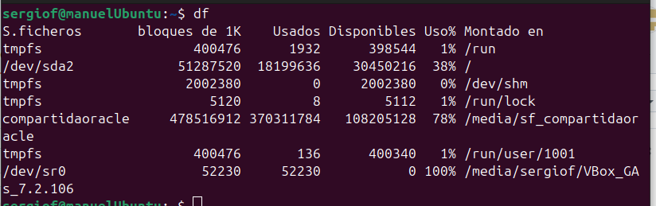
* **Interpretación:** Permite ver el porcentaje de ocupación de los discos para evitar llenados.

### `du`
* **Finalidad:** Estima el espacio ocupado por archivos y carpetas específicas.
* **Sintaxis:** `du [opciones] [ruta]` (Ej: `du -sh /var/log`)
* **Captura:** 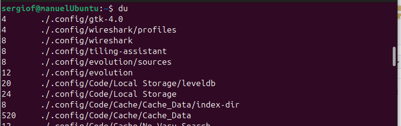
* **Interpretación:** Localiza qué directorios concretos están consumiendo más espacio.

### `iostat`
* **Finalidad:** Informa sobre la carga y el rendimiento de los discos de almacenamiento.
* **Sintaxis:** `iostat [opciones]` (Ej: `iostat -d 2`)
* **Captura:** 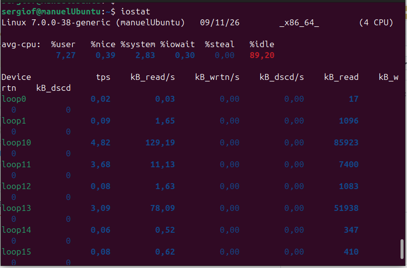
* **Interpretación:** Muestra la velocidad de lectura/escritura y el porcentaje de uso del disco.

---

## 4. Tráfico de red

### `tcpdump`
* **Finalidad:** Captura y analiza el tráfico de red TCP/IP que pasa por las interfaces.
* **Sintaxis:** `sudo tcpdump [opciones]` (Ej: `sudo tcpdump -i eth0`)
* **Captura:** 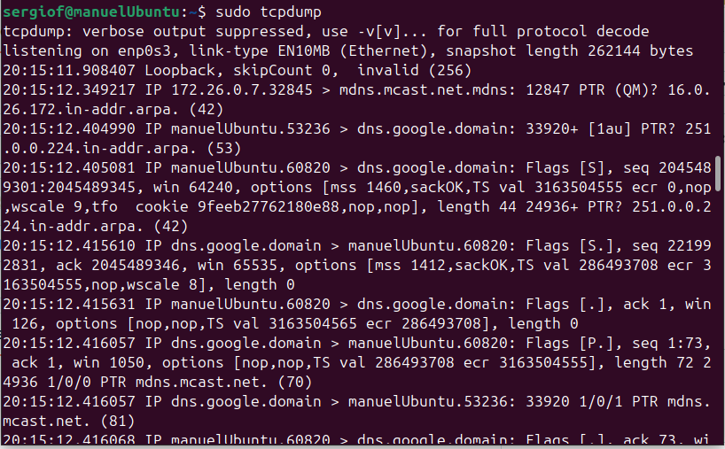
* **Interpretación:** Muestra los paquetes enviados y recibidos para depurar problemas de red.

---

## 5. Puertos y conexiones

### `ss`
* **Finalidad:** Inspecciona conexiones de red activas y puertos abiertos localmente.
* **Sintaxis:** `ss [opciones]` (Ej: `ss -tulpn`)
* **Captura:** 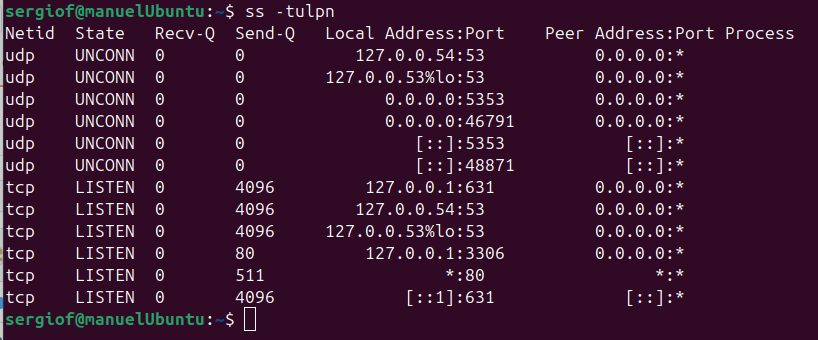
* **Interpretación:** Lista los servicios que están escuchando en la máquina.

### `nmap`
* **Finalidad:** Escanea puertos y servicios en redes locales o remotas.
* **Sintaxis:** `nmap [opciones] [IP]` (Ej: `nmap -p 80 127.0.0.1`)
* **Captura:** 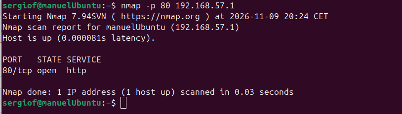
* **Interpretación:** Verifica qué puertos están abiertos y accesibles desde el exterior.

---

## 6. Análisis de resultados

1. **¿Cómo comprobarías la cantidad de memoria RAM disponible?**
   Con `free -h`, mirando el valor de la columna `available`.
2. **¿Qué diferencia existe entre `df` y `du`?**
   `df` mide el espacio a nivel de particiones/sistemas de archivos, y `du` mide el espacio que ocupa una carpeta o archivo específico.
3. **¿Qué diferencias existen entre `ss` y `nmap`?**
   `ss` consulta las conexiones internas del propio equipo, mientras que `nmap` escanea los puertos mediante peticiones de red.
4. **¿Cómo comprobarías si un servidor tiene abierto el puerto 80?**
   Localmente con `ss -tulpn | grep :80` o externamente con `nmap -p 80 <IP>`.
5. **¿Qué herramienta utilizarías para detectar un posible cuello de botella en el disco?**
   `iostat` (o `iotop`), revisando el porcentaje de uso (`%util`) y tiempos de espera.
6. **¿Por qué es importante monitorizar los recursos de un servidor?**
   Para garantizar la disponibilidad, prevenir caídas por falta de recursos, detectar fallos a tiempo y planificar mejoras de hardware.
